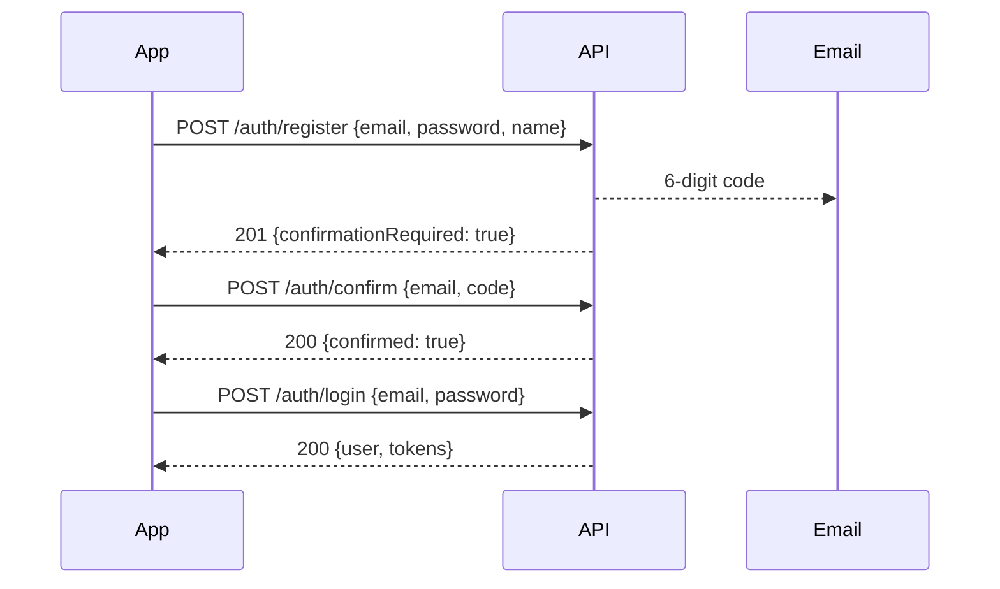

# Auth API

Accounts and sessions. None of these routes need a token.

| Method | Path | Purpose |
|--------|------|---------|
| `POST` | `/auth/register` | Create an account; a confirmation code is emailed |
| `POST` | `/auth/confirm` | Confirm the account with that code |
| `POST` | `/auth/login` | Sign in and receive tokens |
| `POST` | `/auth/refresh` | Get a new ID token without the password |

Read the [API Guide](./README.md) first for the base URL, conventions, and the error format.

---

## Sign-up flow



The account cannot sign in until it is confirmed. The code expires after 24 hours; after that the user must register again.

---

## Register

`POST /auth/register`

```bash
curl -s -X POST "$BASE/auth/register" \
  -H "Content-Type: application/json" \
  -d '{"email":"operator@example.com","password":"<password>","name":"Your Name"}'
```

| Field | Required | Rules |
|-------|----------|-------|
| `email` | Yes | A valid email address. Trimmed and lower-cased; the user's identity is the lower-cased form. Max 254 characters. |
| `password` | Yes | 8–256 characters with at least one upper-case letter, one lower-case letter, one digit, and one symbol. Must not equal the email. |
| `name` | Yes | 1–128 characters. Shown as `user.name` after sign-in. |

`201 Created`:

```json
{
  "email": "operator@example.com",
  "confirmationRequired": true
}
```

Validate the password rules on the client before calling, so the user gets instant feedback. The server enforces them again.

| Status | Message |
|--------|---------|
| `400` | `Email is required.` / `Enter a valid email address.` |
| `400` | `Name is required.` / `Name must be 1 to 128 characters.` |
| `400` | `Password is required.` / `Password is too long.` |
| `400` | `Password must be at least 8 characters and include an uppercase letter, a lowercase letter, a number, and a symbol.` |
| `400` | `Password must not match the email address.` |
| `400` | `Check the email, name, and password and try again.` |
| `409` | `An account with this email already exists.` |
| `502` | `Could not send the confirmation email.` |

---

## Confirm

`POST /auth/confirm`

```bash
curl -s -X POST "$BASE/auth/confirm" \
  -H "Content-Type: application/json" \
  -d '{"email":"operator@example.com","code":"123456"}'
```

| Field | Required | Rules |
|-------|----------|-------|
| `email` | Yes | Same email used to register. |
| `code` | Yes | The 6 digits from the email, as a string. |

`200 OK`:

```json
{
  "email": "operator@example.com",
  "confirmed": true
}
```

| Status | Message |
|--------|---------|
| `400` | `Enter the 6-digit confirmation code.` |
| `400` | `That confirmation code is not valid.` |
| `400` | `That confirmation code has expired. Register again to receive a new code.` |
| `404` | `No account is waiting for confirmation for that email.` |
| `409` | `This account is already confirmed. Sign in instead.` |
| `500` | `Could not finish creating the account.` |

There is no "resend code" route yet. If the code is lost, register again with the same email after it expires, or ask the Baruch team to confirm the account.

---

## Login

`POST /auth/login`

```bash
curl -s -X POST "$BASE/auth/login" \
  -H "Content-Type: application/json" \
  -d '{"email":"operator@example.com","password":"<password>"}'
```

| Field | Required |
|-------|----------|
| `email` | Yes |
| `password` | Yes |

`200 OK`:

```json
{
  "user": {
    "id": "36a25274-6001-706d-5913-adf36a8d1e90",
    "email": "operator@example.com",
    "name": "Your Name",
    "role": "Operator"
  },
  "tokens": {
    "idToken": "eyJraWQiOi...",
    "accessToken": "eyJraWQiOi...",
    "refreshToken": "eyJjdHkiOi...",
    "expiresIn": 3600
  }
}
```

| Field | Use |
|-------|-----|
| `user.id` | Stable identifier for the account. Needed for `/auth/refresh`. Store it with the tokens. |
| `user.role` | `Operator` or `Administrator`. See [Roles](./README.md#roles). |
| `tokens.idToken` | Send as `Authorization: Bearer <idToken>` on every protected route. |
| `tokens.accessToken` | Not needed by the current API. Safe to ignore. |
| `tokens.refreshToken` | Keep securely. Used by `/auth/refresh`. Valid for 30 days. |
| `tokens.expiresIn` | Seconds until `idToken` expires (3600). |

An unknown email and a wrong password return the same message so the API never reveals whether an account exists.

| Status | Message |
|--------|---------|
| `401` | `Invalid email or password.` |
| `403` | `Confirm your email before signing in.` |
| `403` | `Password reset is required.` |
| `403` | `Additional sign-in steps are required.` |

---

## Refresh

`POST /auth/refresh`

Call this when a protected route returns `401`, or proactively a few minutes before `expiresIn` runs out. It does not need the password.

```bash
curl -s -X POST "$BASE/auth/refresh" \
  -H "Content-Type: application/json" \
  -d '{"userId":"36a25274-6001-706d-5913-adf36a8d1e90","refreshToken":"eyJjdHkiOi..."}'
```

| Field | Required | Rules |
|-------|----------|-------|
| `userId` | Yes | The `user.id` from login. |
| `refreshToken` | Yes | The `tokens.refreshToken` from login. |

`200 OK` — same shape as login, but **without a new `refreshToken`**. Keep using the one from login.

```json
{
  "user": { "id": "36a2…", "email": "operator@example.com", "name": "Your Name", "role": "Operator" },
  "tokens": { "idToken": "eyJraWQiOi...", "accessToken": "eyJraWQiOi...", "expiresIn": 3600 }
}
```

| Status | Message | What to do |
|--------|---------|------------|
| `400` | `userId is required.` / `refreshToken is required.` / `… is not valid.` | Fix the request |
| `401` | `Session has expired. Sign in again.` | Clear stored tokens and show the sign-in screen |
| `403` | `Confirm your email before signing in.` / `Password reset is required.` | Show the message |

---

## Client examples

Each example signs in, then calls a protected route, retrying once after a refresh if the token has expired.

### JavaScript / TypeScript (fetch)

```ts
const BASE = "https://v8yde6qhhh.execute-api.eu-west-2.amazonaws.com";

type Session = {
  user: { id: string; email: string; name: string; role: "Operator" | "Administrator" };
  tokens: { idToken: string; accessToken: string; refreshToken?: string; expiresIn: number };
};

async function post<T>(path: string, body: unknown, token?: string): Promise<T> {
  const res = await fetch(BASE + path, {
    method: "POST",
    headers: { "Content-Type": "application/json", ...(token && { Authorization: `Bearer ${token}` }) },
    body: JSON.stringify(body),
  });
  const data = await res.json();
  if (!res.ok) throw Object.assign(new Error(data.message ?? "Request failed"), { status: res.status });
  return data as T;
}

export async function login(email: string, password: string): Promise<Session> {
  return post<Session>("/auth/login", { email, password });
}

export async function refresh(session: Session): Promise<Session> {
  const next = await post<Session>("/auth/refresh", {
    userId: session.user.id,
    refreshToken: session.tokens.refreshToken,
  });
  // Refresh does not return a new refresh token; keep the original.
  next.tokens.refreshToken = session.tokens.refreshToken;
  return next;
}

export async function authedGet<T>(path: string, session: Session, onSession: (s: Session) => void): Promise<T> {
  const call = (token: string) => fetch(BASE + path, { headers: { Authorization: `Bearer ${token}` } });
  let res = await call(session.tokens.idToken);
  if (res.status === 401) {
    const fresh = await refresh(session); // throws 401 if the refresh token is also dead
    onSession(fresh);
    res = await call(fresh.tokens.idToken);
  }
  const data = await res.json();
  if (!res.ok) throw Object.assign(new Error(data.message), { status: res.status });
  return data as T;
}
```

### Android (Kotlin, OkHttp + kotlinx.serialization)

```kotlin
@Serializable data class User(val id: String, val email: String, val name: String, val role: String)
@Serializable data class Tokens(val idToken: String, val accessToken: String, val refreshToken: String? = null, val expiresIn: Int)
@Serializable data class Session(val user: User, val tokens: Tokens)
@Serializable data class ApiError(val message: String)

class ApiException(val status: Int, message: String) : Exception(message)

class BaruchApi(private val base: String = "https://v8yde6qhhh.execute-api.eu-west-2.amazonaws.com") {
    private val client = OkHttpClient()
    private val json = Json { ignoreUnknownKeys = true }
    private val jsonMedia = "application/json".toMediaType()

    suspend fun login(email: String, password: String): Session =
        post("/auth/login", mapOf("email" to email, "password" to password))

    suspend fun refresh(session: Session): Session {
        val next: Session = post("/auth/refresh", mapOf("userId" to session.user.id, "refreshToken" to session.tokens.refreshToken!!))
        return next.copy(tokens = next.tokens.copy(refreshToken = session.tokens.refreshToken))
    }

    suspend inline fun <reified T> get(path: String, session: Session, onSession: (Session) -> Unit): T {
        var response = execute(Request.Builder().url(base + path).header("Authorization", "Bearer ${session.tokens.idToken}").build())
        if (response.code == 401) {
            val fresh = refresh(session)
            onSession(fresh)
            response = execute(Request.Builder().url(base + path).header("Authorization", "Bearer ${fresh.tokens.idToken}").build())
        }
        return decode(response)
    }

    private suspend inline fun <reified T> post(path: String, body: Map<String, String>, token: String? = null): T {
        val request = Request.Builder().url(base + path)
            .post(json.encodeToString(body).toRequestBody(jsonMedia))
            .apply { token?.let { header("Authorization", "Bearer $it") } }
            .build()
        return decode(execute(request))
    }

    private suspend fun execute(request: Request): Response = withContext(Dispatchers.IO) { client.newCall(request).execute() }

    private inline fun <reified T> decode(response: Response): T {
        val text = response.body?.string().orEmpty()
        if (!response.isSuccessful) {
            val message = runCatching { json.decodeFromString<ApiError>(text).message }.getOrDefault("Request failed")
            throw ApiException(response.code, message)
        }
        return json.decodeFromString(text)
    }
}
```

Store `Session` with `EncryptedSharedPreferences`. Treat `ApiException(401, …)` from `refresh` as "signed out".

### iOS (Swift, URLSession + Codable)

```swift
struct User: Codable { let id: String; let email: String; let name: String; let role: String }
struct Tokens: Codable { let idToken: String; let accessToken: String; var refreshToken: String?; let expiresIn: Int }
struct Session: Codable { let user: User; var tokens: Tokens }
struct APIError: Codable, Error { let message: String }

enum APIFailure: Error { case http(status: Int, message: String) }

final class BaruchAPI {
    let base = URL(string: "https://v8yde6qhhh.execute-api.eu-west-2.amazonaws.com")!

    func login(email: String, password: String) async throws -> Session {
        try await post("/auth/login", body: ["email": email, "password": password])
    }

    func refresh(_ session: Session) async throws -> Session {
        var next: Session = try await post("/auth/refresh", body: ["userId": session.user.id, "refreshToken": session.tokens.refreshToken ?? ""])
        next.tokens.refreshToken = session.tokens.refreshToken   // refresh does not return a new one
        return next
    }

    func get<T: Decodable>(_ path: String, session: Session, onSession: (Session) -> Void) async throws -> T {
        var (data, status) = try await send(path, method: "GET", token: session.tokens.idToken)
        if status == 401 {
            let fresh = try await refresh(session)
            onSession(fresh)
            (data, status) = try await send(path, method: "GET", token: fresh.tokens.idToken)
        }
        return try decode(data, status: status)
    }

    private func post<T: Decodable>(_ path: String, body: [String: String], token: String? = nil) async throws -> T {
        let (data, status) = try await send(path, method: "POST", token: token, body: try JSONEncoder().encode(body))
        return try decode(data, status: status)
    }

    private func send(_ path: String, method: String, token: String?, body: Data? = nil) async throws -> (Data, Int) {
        var request = URLRequest(url: URL(string: path, relativeTo: base)!)   // keeps query strings intact
        request.httpMethod = method
        request.httpBody = body
        if body != nil { request.setValue("application/json", forHTTPHeaderField: "Content-Type") }
        if let token { request.setValue("Bearer \(token)", forHTTPHeaderField: "Authorization") }
        let (data, response) = try await URLSession.shared.data(for: request)
        return (data, (response as? HTTPURLResponse)?.statusCode ?? 0)
    }

    private func decode<T: Decodable>(_ data: Data, status: Int) throws -> T {
        guard (200..<300).contains(status) else {
            let message = (try? JSONDecoder().decode(APIError.self, from: data))?.message ?? "Request failed"
            throw APIFailure.http(status: status, message: message)
        }
        return try JSONDecoder().decode(T.self, from: data)
    }
}
```

Store `Session` in the Keychain. Percent-encode query values with `addingPercentEncoding(withAllowedCharacters: .urlQueryAllowed)` before building a path such as `/devices?mac=…`.
