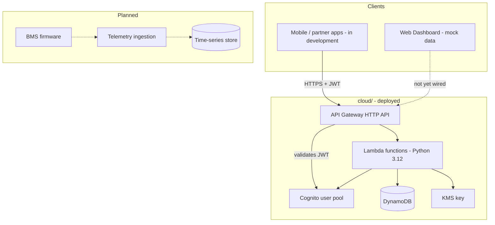
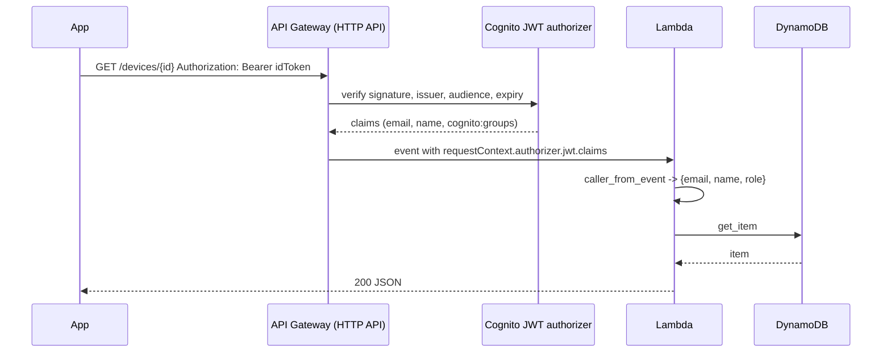
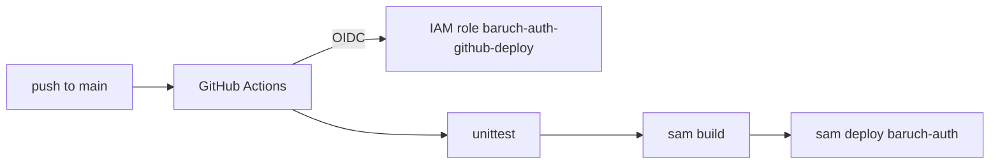

# Architecture Overview

Internal. Last updated November 2026.

## System context



## Repository structure

| Directory | Responsibility | Status |
|-----------|----------------|--------|
| `web/` | React SPA — fleet list, device detail, auth, profile | MVP on mock data; not yet connected to the API |
| `cloud/` | Auth, products, and devices APIs | Deployed (`baruch-auth` stack, `eu-west-2`) |
| `embedded/` | BMS / gateway firmware | Planned |
| `docs/api/` | API docs for app developers | Current |
| `docs/internal/` | Engineering docs (this folder) | Current |

---

## Cloud architecture (implemented)

Everything is defined in `cloud/template.yaml` (AWS SAM) and deployed by GitHub Actions. See [deployment.md](./deployment.md).

### Request path



- The JWT is verified by API Gateway, not by our code. Functions behind `CognitoJwt` never run for a bad token; the gateway returns `401 {"message":"Unauthorized"}`.
- Inside a function, `shared/auth_context.py` reads the claims and derives the role: `Administrator` if the `cognito:groups` claim contains `Administrator`, otherwise `Operator`. `require_administrator()` raises `403`.
- The `/auth/*` routes are public and talk to Cognito directly with the app client secret (`SECRET_HASH`).

### Routes and functions

| Route | Function (`baruch-auth-…`) | Handler | Auth |
|-------|----------------------------|---------|------|
| `POST /auth/register` | `register` | `auth.register` | public |
| `POST /auth/confirm` | `confirm` | `auth.confirm` | public |
| `POST /auth/login` | `login` | `auth.login` | public |
| `POST /auth/refresh` | `refresh` | `auth.refresh` | public |
| (Cognito trigger) | `post-confirmation` | `auth.post_confirmation` | — |
| `POST /products` | `create-product` | `products.create` | JWT, admin |
| `GET /products/{serialNumber}` | `get-product` | `products.get` | JWT |
| `GET /products` | `list-products` | `products.list` | JWT |
| `GET /products/{serialNumber}/history` | `product-history` | `products.history` | JWT |
| `GET /audit` | `audit-by-actor` | `products.audit` | JWT, admin |
| `POST /devices` | `register-device` | `devices.register` | JWT, admin |
| `GET /devices/{deviceId}` | `get-device` | `devices.get` | JWT |
| `GET /devices` | `find-device` | `devices.find` | JWT |
| `POST /devices/{deviceId}/activation-key` | `rotate-activation-key` | `devices.rotate_key` | JWT, admin |
| `GET /devices/{deviceId}/history` | `device-history` | `products.history` | JWT |

"admin" means the handler calls `require_administrator`; the gateway only checks the token is valid.

### Code layout

```
cloud/
├── template.yaml              SAM: Cognito, HTTP API, functions, tables, KMS
├── deploy/github-deploy-role.yaml   IAM role GitHub assumes via OIDC
├── src/
│   ├── auth/                  register, confirm, login, refresh, post_confirmation
│   ├── products/              create, get, list, history, audit
│   ├── devices/               register, get, find, rotate_key
│   └── shared/
│       ├── http.py            json_response, read_json_body (8 KB cap), respond_to_error
│       ├── errors.py          HttpError, Cognito error → HTTP mapping
│       ├── auth_context.py    caller_from_event, require_administrator
│       ├── cognito.py         sign_up, confirm_sign_up, login, refresh, groups
│       ├── secret_hash.py     Cognito SECRET_HASH
│       ├── validate*.py       request body rules per domain
│       ├── serial.py          BMS-YYYY-NNNNNN
│       ├── device_ids.py      ULID device ids, key generation, activation-key hashing
│       ├── products.py        BmsProducts + BmsSerialCounters access
│       ├── devices.py         BmsDevices + BmsDeviceMacs access, KMS encrypt, transaction
│       └── audit.py           BmsAuditLog entries and queries
└── tests/                     unittest; mocks boto3 at the module boundary
```

Each Lambda gets only the environment variables and IAM permissions it uses (per-function `Policies` in the template). Functions are Python 3.12 on arm64, 256 MB, 10 s timeout.

### Data stores

Five DynamoDB tables, on-demand billing, all retained on stack deletion. Full schema in [data-model.md](./data-model.md).

| Table | Key | Purpose |
|-------|-----|---------|
| `BmsProducts` | `serialNumber` | Factory inventory |
| `BmsSerialCounters` | `counterId` (year) | Atomic per-year serial sequence |
| `BmsDevices` | `deviceId` | Registered BMS units, ours and external |
| `BmsDeviceMacs` | `macAddress` | MAC uniqueness and lookup |
| `BmsAuditLog` | `subjectId` + `occurredAt` | Who did what, to products and devices |

Multi-table writes (create product + audit, register device + MAC + audit + product update) use `TransactWriteItems` so they are all-or-nothing. Uniqueness (serial, MAC, device id) is enforced with `attribute_not_exists` conditions inside the transaction, and `CancellationReasons` are mapped to `409` messages.

### Identity

Cognito user pool `baruch-auth-users`: email is the username (case-insensitive), `name` is required, email auto-verified by code. Groups `Operator` (precedence 10) and `Administrator` (precedence 1). The app client has a secret and allows only `ADMIN_USER_PASSWORD_AUTH` and `REFRESH_TOKEN_AUTH`; there is no hosted UI. A post-confirmation trigger adds every self-registered user to `Operator`.

Token lifetimes are Cognito defaults: ID/access 1 hour, refresh 30 days. `POST /auth/refresh` needs the user's `sub` because Cognito computes the refresh-flow `SECRET_HASH` from it; login returns it as `user.id`.

### Secrets handling

| Secret | Storage | Returned |
|--------|---------|----------|
| Instant reading key | KMS-encrypted (`alias/baruch-auth-device-keys`, encryption context `deviceId` + field) in `BmsDevices` | Once, at registration |
| Activation key | SHA-256 hex of the normalised key in `BmsDevices` | Once, at registration or rotation |
| Cognito app client secret | Lambda environment variable, from `!GetAtt UserPoolClient.ClientSecret` | Never |

Only `register-device` has `kms:Encrypt`. Nothing has `kms:Decrypt` yet; the telemetry ingestion service will, when it exists.

### Deploy pipeline



---

## Web application (MVP, unchanged)

The dashboard still runs on mock data in `web/src/data/`. Its tech stack, routing, and layout are as originally designed:

| Layer | Technology |
|-------|------------|
| Framework | React 19 + TypeScript, Vite 8, React Router 7 |
| Styling | Tailwind CSS 4 |
| Charts / maps | Recharts, Leaflet |

| Path | Component | Auth |
|------|-----------|------|
| `/login` | LoginPage | No |
| `/devices` | DeviceListPage | Yes |
| `/devices/:deviceId` | DeviceDetailPage | Yes |
| `/profile` | UserProfilePage | Yes |

Connecting it to the API means replacing `authenticateUser()` with `POST /auth/login`, keeping the session in memory plus the refresh token in secure storage, and swapping `mockDevices` for `GET /devices` once a list route exists. Telemetry (SOC, cells) has no backend yet.

---

## Security summary

| Area | Current |
|------|---------|
| Transport | HTTPS only (API Gateway) |
| Authentication | Cognito JWTs verified at the gateway; 1-hour ID tokens, 30-day refresh |
| Authorisation | Role from Cognito groups, enforced per handler |
| Secrets | Client secret in Lambda env; device keys KMS-encrypted or hashed; nothing in source |
| Rate limiting | 10 rps, burst 20, API-wide |
| Audit | Every write to products and devices logged with actor, IP, user agent, request id |
| Input | All bodies validated; 8 KB cap; enumerations closed |
| Infrastructure | Least-privilege per function; deploy role scoped to one stack |

Known gaps: no WAF, no per-user rate limits, no password reset or resend-code route, CORS open (`*`) for development.
