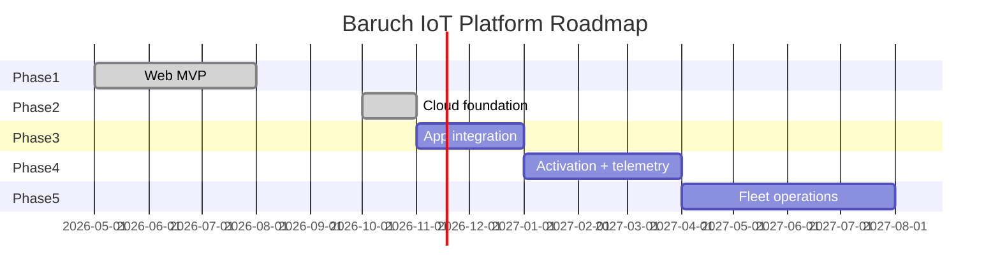

# Product Roadmap

Internal. Last updated November 2026.

---

## Phase 1 — Web MVP

**Status:** Done (August 2026)
**Goal:** Validate UX and dashboard layout with mock data

| Deliverable | Status |
|-------------|--------|
| Login / logout with mock auth | Done |
| Device fleet list and map | Done |
| Device detail dashboard (SOC chart, scorecard, cells) | Done |
| User profile page | Done |
| Resizable panels | Done |
| Product documentation | Done |

---

## Phase 2 — Cloud foundation

**Status:** Done (November 2026). Deployed as the `baruch-auth` stack; documented in [docs/api](../api/README.md).

| Feature | Status | Notes |
|---------|--------|-------|
| User registration, email confirmation, sign-in | Done | Cognito, JWT tokens |
| Session refresh | Done | `POST /auth/refresh` |
| Roles | Done | Operator / Administrator via Cognito groups |
| Factory product records and serial numbers | Done | `BMS-YYYY-NNNNNN`, atomic counter |
| Device registration by MAC | Done | ULID device ids, factory and external units |
| Instant reading key and activation key issuance | Done | KMS-encrypted / hashed, shown once |
| Activation key rotation | Done | |
| Audit log | Done | Per subject and per actor |
| CI/CD | Done | GitHub Actions → SAM, OIDC role |
| App-developer API documentation | Done | `docs/api/` |

---

## Phase 3 — App integration and account completeness

**Goal:** Partner mobile apps and the web dashboard run on the live API

| Feature | Description |
|---------|-------------|
| Password reset and change | `POST /auth/forgot-password`, `/auth/confirm-forgot-password`, `/auth/change-password` |
| Resend confirmation code | `POST /auth/resend-code` |
| Sign-out / token revocation | Revoke refresh token |
| Device listing | Paginated `GET /devices` (by origin, status, registration date) with cursor pagination |
| Product list pagination | Cursor pagination on `GET /products` |
| Web dashboard on live auth | Replace mock login with `/auth/login` + refresh |
| CORS lock-down | Restrict to dashboard and app origins |

**Exit criteria:** A partner app can register, sign in, stay signed in across days, and register/find devices without Baruch intervention.

---

## Phase 4 — Device activation and telemetry

**Goal:** A BMS in the field pairs with the platform and reports data

| Feature | Description |
|---------|-------------|
| Activation flow | End user enters activation key → `activationStatus: ACTIVATED`, device bound to the user/account |
| Device claiming | Product status `CLAIMED`; ownership model |
| Telemetry ingestion | BMS authenticates with instant reading key (KMS decrypt path); MQTT or HTTPS |
| Time-series storage | SOC, cell voltages, temperature history |
| Current-status API | Latest reading per device for the fleet list |
| Firmware records | Track `firmwareVersion` changes over time |

---

## Phase 5 — Fleet operations

| Feature | Description |
|---------|-------------|
| Alerting | SOC thresholds, offline detection, email/SMS |
| Fleet overlay | Device vs fleet average on the SOC chart |
| Search and filters | Group, status, SOC range |
| Export | CSV/PDF reports |
| Remote configuration | Sampling/upload intervals |
| Firmware OTA | Schedule and track updates |

---

## Technical debt and improvements

| Item | Priority | Notes |
|------|----------|-------|
| Resend-code and password reset | High | App developers will hit this immediately |
| Cursor pagination | High | Lists are capped at 200/500 |
| CORS restriction | High | `*` is development-only |
| Per-user rate limiting / WAF | Medium | API-wide limits only today |
| Retire mock credentials from `web/` | Medium | Once dashboard uses the API |
| Code-split Recharts/Leaflet | Medium | ~790 KB initial bundle |
| E2E tests | Medium | Playwright for web; API smoke test in CI against a staging stack |
| Staging environment | Medium | Second stack and base URL for app developers |
| Dark mode, mobile polish | Low | |

---

## Milestone timeline (indicative)

*Timeline is indicative and subject to prioritisation changes.*
